# MIBEL-Ops — Architecture Diagrams (v0.3 · intraday)

> Requirements: [01](01_requirements.md) · User stories: [02](02_user_stories.md) · Retention: [04](04_retention_policy.md) · Quality: [quality/](quality/README.md) · Data sources: [05](05_data_sources.md) · Decisions: [06](06_technical_decisions.md)
>
> Deployment according to **ADR-01 (accepted)**: Compose on the manager + K3s for compute. Models in **ONNX** (ADR-03). Horizon of **8 quarters** split into nowcast (h1–h4) and forecast (h5–h8) (ADR-04, accepted). Node liveness and failure recovery use native K3s mechanisms (ADR-02). All ADRs are in [06_technical_decisions.md](06_technical_decisions.md).

Contents
1. [Context](#1-context)
2. [MIBEL markets over time](#2-mibel-markets-over-time)
3. [Topology by role](#3-topology-by-role)
4. [Deployment per node](#4-deployment-per-node)
5. [Streaming data flow](#5-streaming-data-flow)
6. [Sequence · One 15-minute window](#6-sequence--one-15-minute-window)
7. [Sequence · Ingestor with the manager off](#7-sequence--ingestor-with-the-manager-off)
8. [Sequence · Drift and distributed retraining](#8-sequence--drift-and-distributed-retraining)
9. [Sequence · Node onboarding](#9-sequence--node-onboarding)
10. [States · Operating modes](#10-states--operating-modes)
11. [States · Model lifecycle](#11-states--model-lifecycle)
12. [Classes · Contracts](#12-classes--contracts)
13. [Point-in-time data model](#13-point-in-time-data-model)
14. [Point-in-time features](#14-point-in-time-features)
15. [Market logic](#15-market-logic)
16. [Future evolution](#16-future-evolution)
17. [Repository structure](#17-repository-structure)

---

## 1. Context

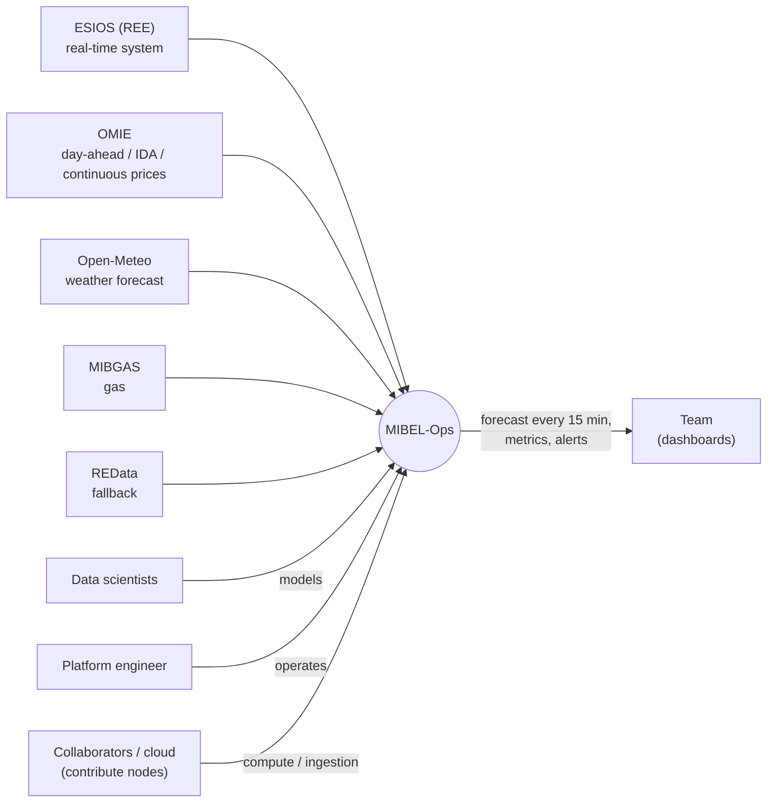

---

## 2. MIBEL markets over time
What is known and when, for delivery day D (all markets use 15-min periods since Oct-2025).

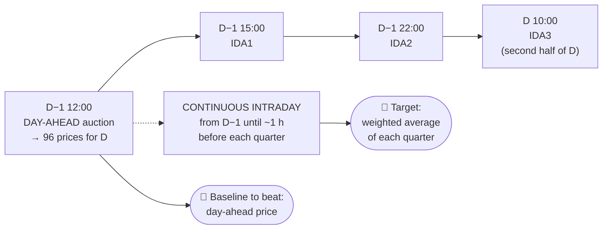

---

## 3. Topology by role

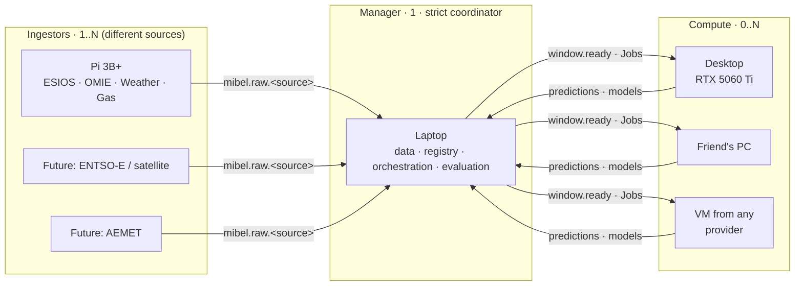

---

## 4. Deployment per node

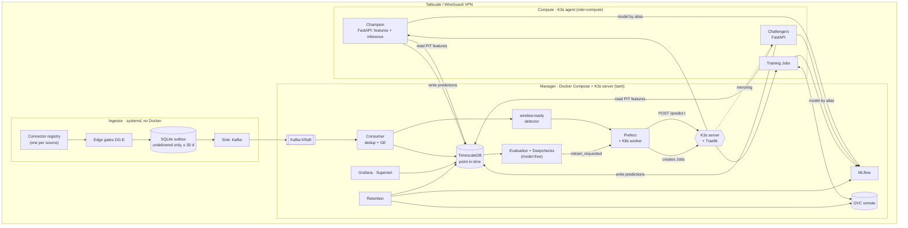

---

## 5. Streaming data flow

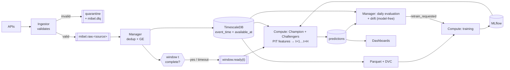

---

## 6. Sequence · One 15-minute window

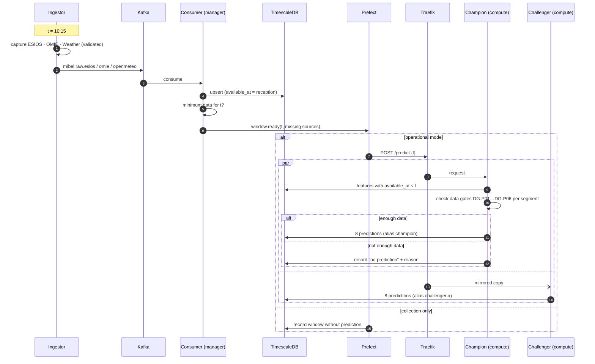

---

## 7. Sequence · Ingestor with the manager off

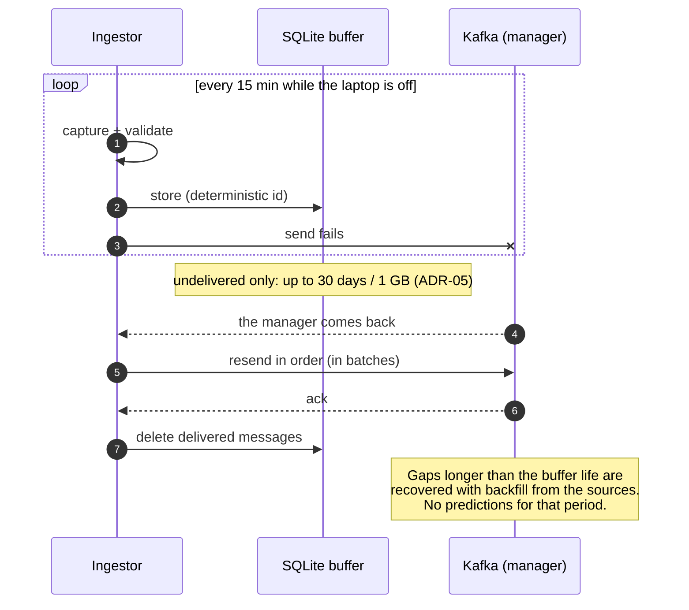

---

## 8. Sequence · Drift and distributed retraining
Queue mechanism details in ADR-02 ([06_technical_decisions.md](06_technical_decisions.md)).

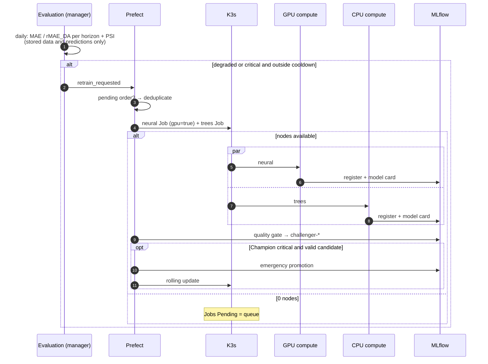

---

## 9. Sequence · Node onboarding

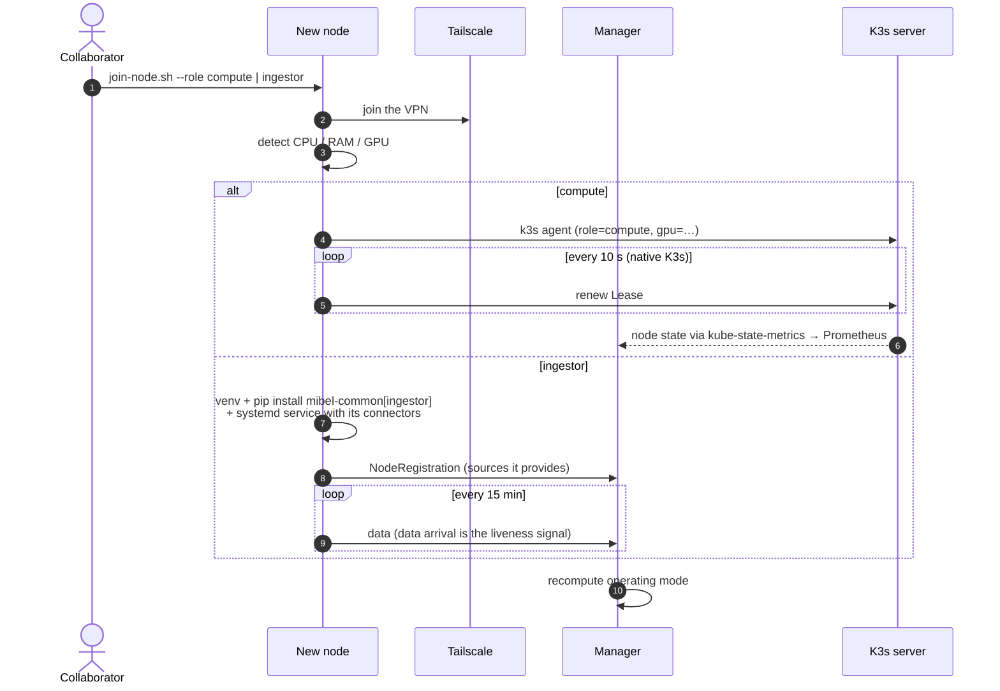

---

## 10. States · Operating modes

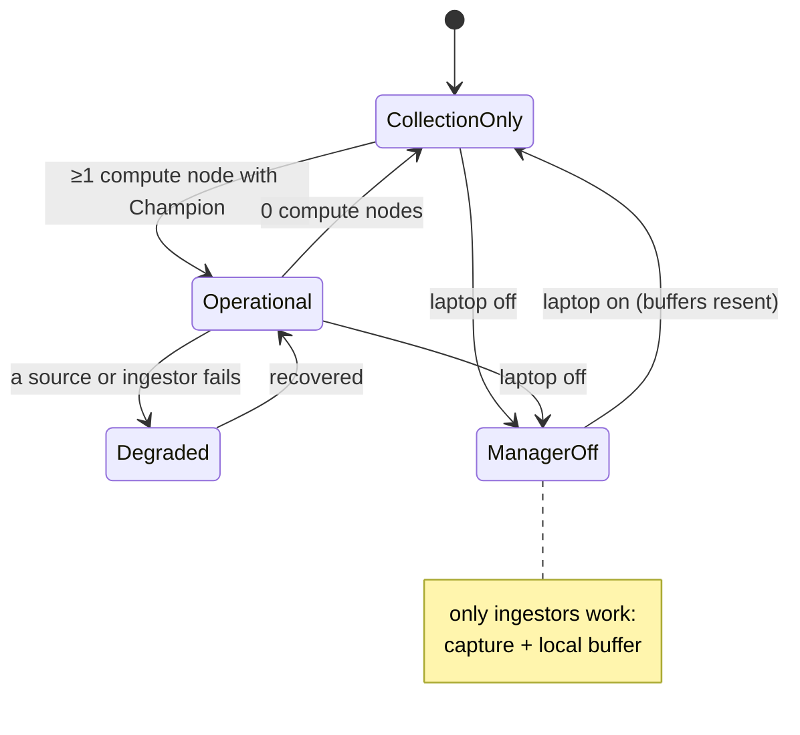

---

## 11. States · Model lifecycle

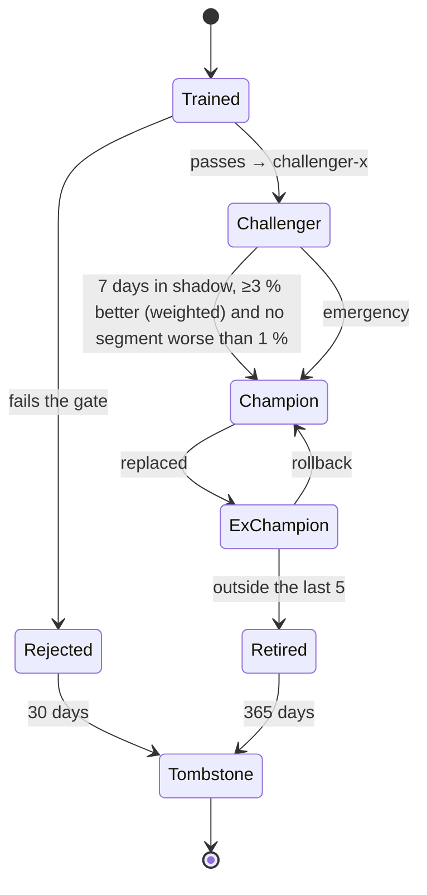

---

## 12. Classes · Contracts

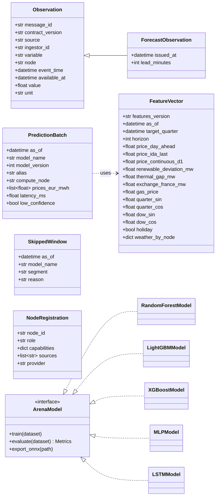

---

## 13. Point-in-time data model

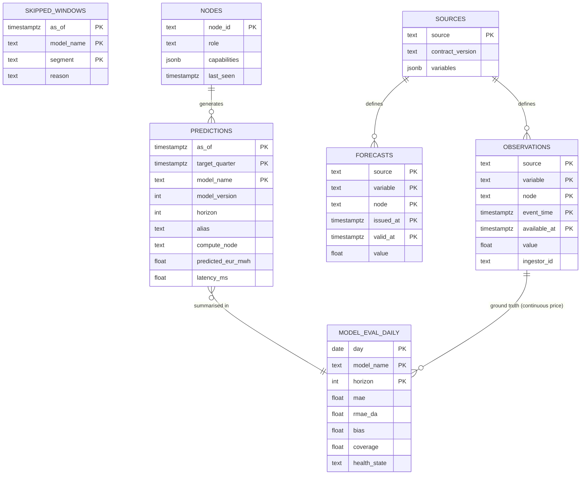

> The **long format** (`source, variable, node`) means a new ingestor with new sources needs no migrations; registering the source in `SOURCES` is enough. Wide views are created for Superset.

---

## 14. Point-in-time features

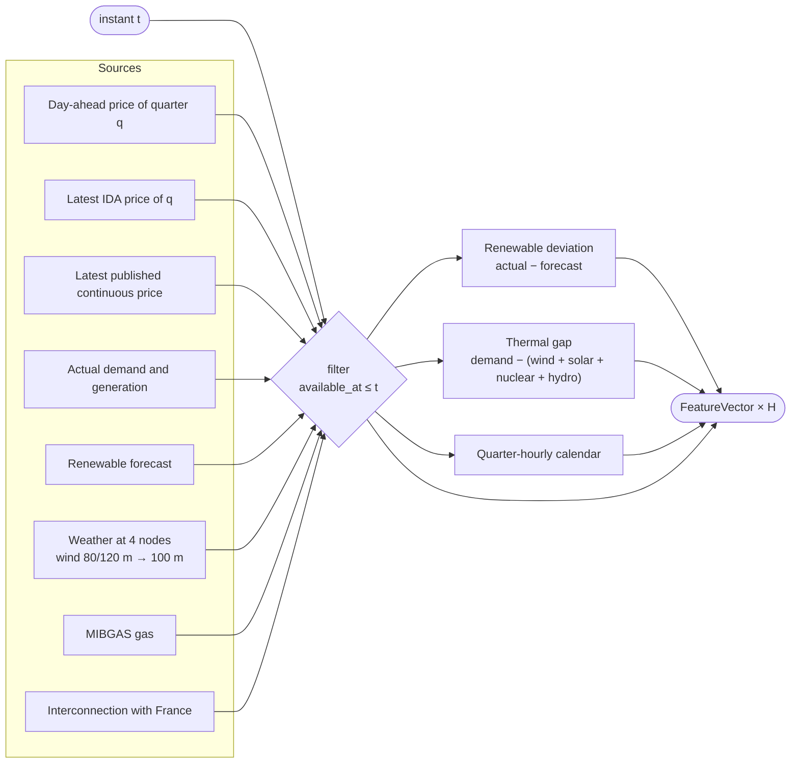

---

## 15. Market logic

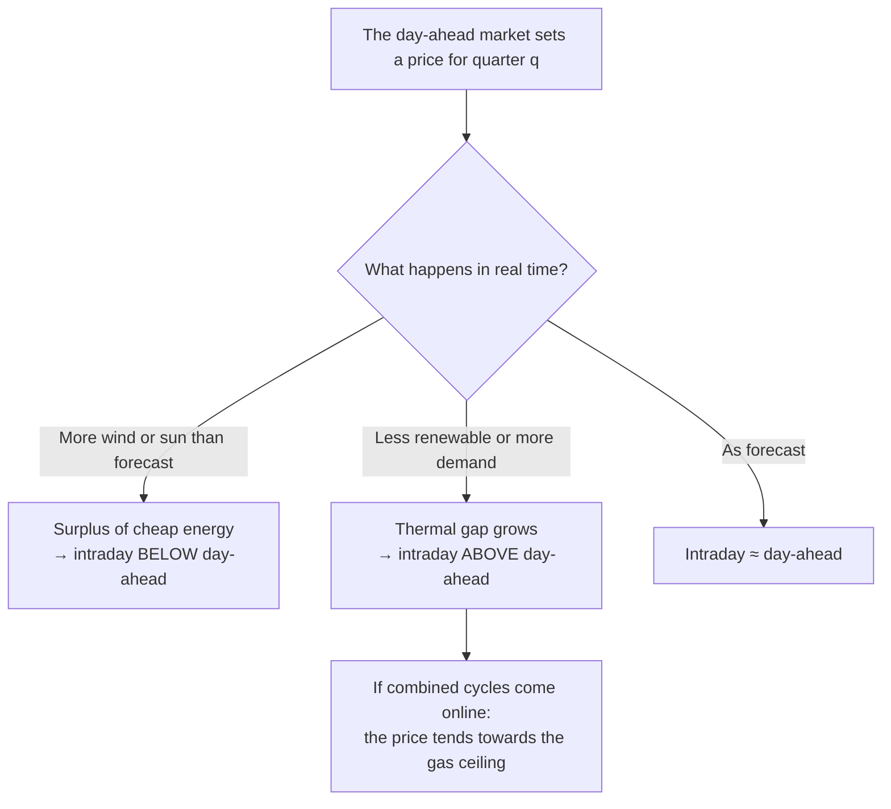

---

## 16. Future evolution

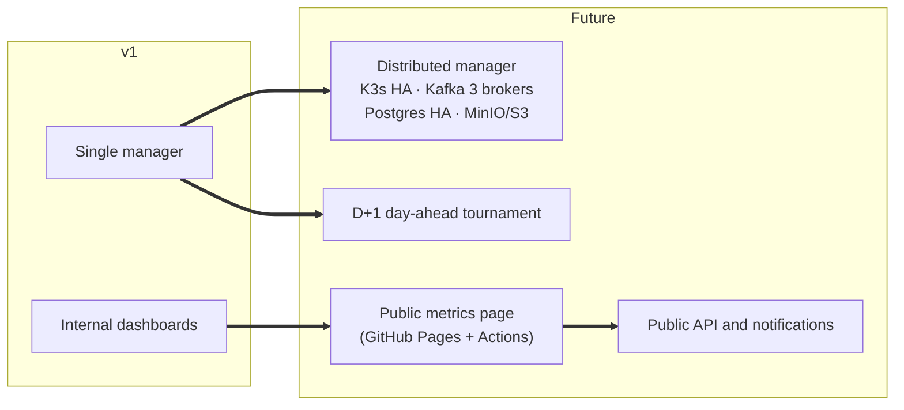

---

## 17. Repository structure

```text
mibel-ops/
├── packages/
│   └── mibel_common/                 # installed on ALL nodes
│       ├── pyproject.toml            #   extras: [ingestor] [manager] [compute]
│       └── mibel_common/
│           ├── contracts/            #   one schema per source + features + prediction + node
│           ├── rules/                #   physical rules (lightweight core, no pandas)
│           ├── features/             #   point-in-time, thermal gap, renewable deviation  [compute]
│           └── config/
│
├── nodes/
│   ├── ingestor/                     # ── INGESTOR · lightweight, systemd, self-contained (ADR-05)
│   │   ├── pyproject.toml            #   package mibel-ingestor · extras [excel] [kafka] [dev]
│   │   ├── requirements.lock.txt     #   runtime pins for the nodes
│   │   ├── config/                   #   ingestor.yaml (sources, cadences, modes) · quality.yaml (DG-E)
│   │   ├── src/mibel_ingestor/
│   │   │   ├── connectors/           #   base.py (port + registry) · one module per source
│   │   │   ├── pipeline.py           #   requests → parse → change detection → gates → outbox
│   │   │   ├── gates.py · store.py · sinks.py · scheduler.py · metrics.py · cli.py
│   │   ├── tests/                    #   contract tests per connector, synthetic payloads
│   │   ├── benchmarks/               #   bench.py: dev PC vs Raspberry Pi
│   │   └── deploy/                   #   install.sh · mibel-ingestor.service · env.example
│   │
│   ├── manager/                      # ── MANAGER · strict coordinator
│   │   ├── consumer/                 #   Kafka → dedup → GE → TimescaleDB · window.ready
│   │   ├── expectations/
│   │   ├── storage/                  #   migrations, compression, wide views
│   │   ├── dataset/                  #   Parquet + DVC
│   │   ├── registry/                 #   aliases, quality gate, promotion, rollback
│   │   ├── orchestration/            #   Prefect flows and automations
│   │   ├── evaluation/               #   metrics, internal baselines, model-free Deepchecks, health states
│   │   ├── node_registry/
│   │   ├── retention/
│   │   ├── dashboards/               #   grafana/ · superset/
│   │   ├── requirements.txt
│   │   └── deploy/                   #   docker-compose.yml · k3s-server/ · traefik/
│   │
│   └── compute/                      # ── COMPUTE · train, serve, predict
│       ├── arena/
│       │   ├── base.py               #   ArenaModel interface
│       │   ├── trees/  neural/  community/
│       │   └── evaluation/           #   walk-forward, model card
│       ├── training/                 #   Job entry point
│       ├── serving/                  #   FastAPI: PIT features + ONNX Runtime inference (CPU/CUDA)
│       ├── requirements.txt
│       └── deploy/                   #   Dockerfile.cuda · Dockerfile.cpu · k8s/ (Deployment, Job, mirroring)
│
├── infra/
│   ├── join-node.sh
│   ├── vpn/
│   └── cloud/                        # generic VM template (cloud-init), no provider-specific services
├── config/                           # settings.yaml · retention.yaml · sources.yaml · quality/{data_gates,service_baseline,promotion}.yaml
├── data/                             # *.dvc
├── tests/                            # cross-node: unit · point-in-time · e2e (node tests live in each node)
├── wip/                              # untested work in progress (notebooks, prototypes); local only, ignored by Git
├── docs/
├── .env.example                      # ESIOS / ENTSO-E tokens (never in the repo)
└── .github/workflows/                # CI (Python version matrix) + images per role
```

Installation per role (no `uv`):
```bash
python -m venv .venv && source .venv/bin/activate
pip install -e packages/mibel_common[manager]    # or [compute]
pip install -r nodes/ingestor/requirements.lock.txt && pip install --no-deps -e nodes/ingestor   # ingestor: self-contained
```
