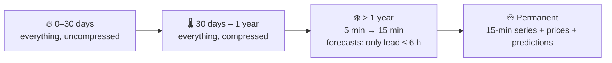

# MIBEL-Ops — Retention Policy (v0.2 · intraday)

> Requirement: FR-13 · User story: US-07 · Scope: **manager** (laptop, 350 GB free), plus local cleanup on compute nodes and ingestors.

## 1. Key idea: data fits; artifacts are the problem

Estimated yearly growth on the manager with the intraday focus:

| Item | Volume / year (uncompressed → compressed) | Comment |
|---|---|---|
| Real-time system data (ESIOS, ~12 variables every 5 min) | ~100 MB → ~15 MB | |
| OMIE prices (day-ahead + 3 IDA + continuous, 15 min) | ~30 MB → ~5 MB | |
| Weather forecasts (4 nodes, hourly issue, 48 h horizon) | ~1.5 GB → ~200 MB | Needed for point-in-time; Open-Meteo's 15-min data is interpolated, so it is stored hourly |
| Predictions (6 models × 8 horizons × 96 windows/day) | ~200 MB → ~30 MB | 1.7 M rows/year |
| DVC dataset (15 min, ~80 columns, weekly version) | ~1.5 GB | ~25 MB per version |
| **MLflow artifacts** (retraining every 2 weeks + on drift, 6 families) | **20–150 GB** | The only thing that really grows |
| Deepchecks reports | 2–5 GB | |
| Prometheus (15 days) · DB backups · Kafka (7 days) | 3–8 GB | Bounded by rotation |

**Conclusion:** the 15-minute data, which is the training resolution, takes less than 1 GB per year compressed, so **it is always kept**. Retention focuses on:
1. **sub-15-minute** detail and **old forecast issues**,
2. **models and their artifacts** (with lineage protection),
3. **operational artifacts**.

## 2. Data (TimescaleDB)



| Data | Compress after | Reduction after 1 year | Always kept |
|---|---|---|---|
| System (5 min) | 30 d | Aggregated to 15 min | 15-min series |
| OMIE prices / PVPC / gas | 30 d | — | Everything |
| Weather forecasts (hourly issues) | 30 d | Only issues with lead ≤ 6 h (what intraday uses) | Those issues |
| Predictions | 30 d | — | Everything |
| DLQ | — | Deleted after 90 d | Daily count per source and rule |
| Kafka | — | 7 days / 1 GB per topic | — |

## 3. Models (MLflow)

| Category | What it is | Artifacts | Metadata |
|---|---|---|---|
| **Protected** | Champion, active Challengers and the **last 5 ex-Champions** | Kept | Kept |
| **Retired** | Ex-Champion outside the last 5 | Deleted after 365 d | Forever |
| **Rejected** | Did not pass the quality gate | Deleted after 30 d | Forever |
| **Loose experiment** | Unregistered *run* | The whole run is deleted after 30 d | — |

**Lineage protection:** the DVC version, commit and evaluation report of a protected model are also protected. Every DVC version in use gets a Git tag `dataset/<hash>`, which `dvc gc --all-tags` respects. In addition, the last 8 weekly versions and 1 monthly version for 24 months are kept.

## 4. Operational artifacts
| Item | Retention |
|---|---|
| Deepchecks reports | 180 d (those that triggered a retraining are kept while their model lives) |
| Prometheus | 15 d |
| DB backups | 7 daily + 4 weekly + 6 monthly |
| Logs | 500 MB per node |
| Compute nodes | Weekly image `prune`; cache only of aliased models and the current DVC version |
| **Ingestor buffer** | Up to **30 days or 1 GB** (whichever comes first); emptied once delivery is confirmed. Alert at 80 % (when connected) |

## 5. Disk budget
`storage.budget_gb` = **200 GB** by default (of the 350 GB free), leaving room for the system and other uses.

| Usage | Action |
|---|---|
| 70 % | Warning |
| 85 % | Accelerated policy: Retired, Rejected and report periods halved; Prometheus down to 7 d. **Propose moving the DVC remote to Google Drive** |
| 95 % | Emergency purge of everything unprotected and critical alert |
| Always | Protected items and the 15-min series are never deleted |

> **Google Drive as overflow:** DVC supports Drive natively as a *remote* (`dvc remote add -d gdrive gdrive://<id>`). MLflow artifacts do **not** support it directly. If needed, Retired model artifacts would be moved to Drive with `rclone`, or MLflow's artifact store would be switched to an S3-compatible one (local MinIO or cloud).

## 6. Alternatives
| | A · Conservative | **B · Balanced (recommended)** | C · Aggressive |
|---|---|---|---|
| Protected ex-Champions | 10 | 5 | 2 |
| Rejected | 90 d | 30 d | 7 d |
| 5-min detail | Always | 1 year | 3 months |
| Estimated disk / year | 100–250 GB | **30–80 GB** | 10–25 GB |

Ways to reduce size: limit the depth and number of trees of RF models, and do not store the native format of Rejected models.

## 7. Configuration
```yaml
retention:
  policy: balanced
  storage:
    budget_gb: 200
    watermarks: {warn: 0.70, accelerate: 0.85, emergency: 0.95}
  timeseries:
    compress_after_days: 30
    downsample_sub15m_after_days: 365
    keep_forecast_max_lead_h_after_days: {days: 365, max_lead_h: 6}
    dlq_days: 90
  kafka: {retention_days: 7, retention_gb_per_topic: 1}
  models:
    keep_previous_champions: 5
    rejected_artifacts_days: 30
    retired_artifacts_days: 365
    loose_runs_days: 30
    keep_metadata_forever: true
  dvc: {keep_weekly: 8, keep_monthly_months: 24, overflow_remote: gdrive}
  reports_days: 180
  prometheus_days: 15
  ingestor_buffer: {max_days: 30, max_gb: 1}
  schedule: "0 3 * * 0"
```
