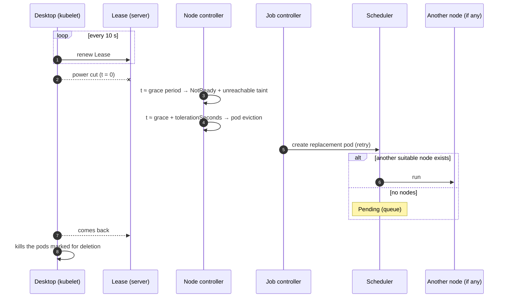
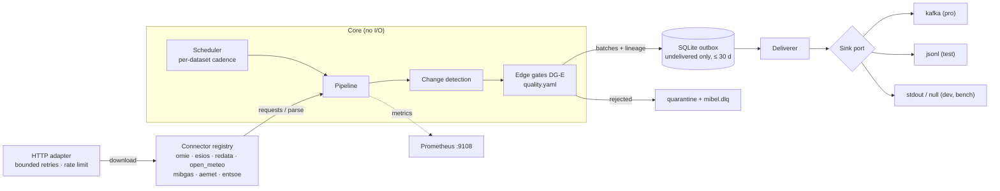

# MIBEL-Ops — Technical Decisions (ADR)

> ADR format (*Architecture Decision Record*): context → options → decision → consequences.
> Statuses: ✅ Accepted · 🟡 Proposed (pending) · ❌ Rejected.

| ADR | Topic | Status |
|---|---|---|
| ADR-00 | Log of accepted decisions | ✅ |
| ADR-01 | Hybrid orchestration: Docker Compose on the manager + K3s for compute | ✅ 2026-11-08 |
| ADR-02 | Job queue with K3s Jobs · node liveness with **native K3s mechanisms + 5 minimal additions** | ✅ 2026-11-08 |
| ADR-03 | Model format: ONNX only | ✅ 2026-11-08 |
| ADR-04 | Horizon: **8 quarters (2 h)**, per-segment safeguards and extension parameters | ✅ 2026-11-08 |
| ADR-05 | Ingestor node architecture: lightweight hexagonal, connector registry, modes `pro`/`test`/`dev` | ✅ 2026-11-11 |

---

## ADR-00 · Log of accepted decisions

| # | Decision | Date |
|---|---|---|
| A-01 | Role-based architecture: ingestors 1..N · manager 1 · compute 0..N | 2026-11-02 |
| A-02 | The manager is a **strict coordinator**: it does not train, serve models or run any computation that uses a model | 2026-11-03 |
| A-03 | Lightweight validation on the ingestor (custom rules; Pydantic dropped in favour of plain dataclasses, see A-22); Great Expectations only on the manager | 2026-11-03 · amended 2026-11-11 |
| A-04 | **Intraday focus**: quarter-hourly price forecast every 15 min | 2026-11-03 |
| A-05 | **No fallback prediction**: if there is no prediction nothing is published and the gap remains visible | 2026-11-03 |
| A-06 | Evaluation and drift on the manager, using only stored data and predictions | 2026-11-03 |
| A-07 | PVPC is kept (captured variable and secondary target) | 2026-11-03 |
| A-08 | Champion/Challenger with **MLflow aliases** | 2026-11-02 |
| A-09 | The thermal gap includes hydro | 2026-11-02 |
| A-10 | MLflow and DVC on the laptop; Google Drive as DVC *remote* if space runs out | 2026-11-03 |
| A-11 | Manager disk: 350 GB free, default budget of 200 GB | 2026-11-03 |
| A-12 | **Provider-agnostic** cloud | 2026-11-03 |
| A-13 | `venv` + `pip`; Python version not pinned | 2026-11-03 |
| A-14 | Public GitHub repository with GitHub Actions (portfolio project) | 2026-11-03 |
| A-15 | Internal dashboards in v1; publishing as future work | 2026-11-03 |
| A-16 | **ADR-01**: Compose on the manager + K3s (*server* with a *taint* on the manager, *agents* on compute) | 2026-11-08 |
| A-17 | **ADR-02**: K3s Jobs act as the queue; node liveness is handled by native K3s mechanisms + 5 minimal additions (Prefect timeout, idempotent registration, node-down alert, node dashboard, closing orphaned runs) | 2026-11-08 |
| A-18 | **ADR-03**: every model is served in ONNX | 2026-11-08 |
| A-19 | **ADR-04**: fixed horizon of 8 quarters, separate safeguards for nowcast and forecast, extension parameters | 2026-11-08 |
| A-20 | Quality split into 3 editable documents (data gates, service baseline, promotion criteria) with development and production profiles | 2026-11-08 |
| A-21 | All repository content (docs, code, comments, configuration, commit messages, branch names) is written in **English** | 2026-11-08 |
| A-22 | **ADR-05**: ingestor = lightweight hexagonal design focused on efficiency, connector registry enabled by configuration, one connector per source, in-process scheduler with a thread pool, SQLite outbox holding only undelivered messages (30 days / 1 GB), modes `pro`/`test`/`dev`, per-node quality YAML, Prometheus metrics | 2026-11-11 |
| A-23 | DG-E11 tolerance (−1 % of installed capacity for thermal and storage) and new DG-E16 (OMIE no-trade periods → missing) | 2026-11-11 |
| A-24 | The target stays the **real continuous VWAP**; since it is published on D+1, the nowcast uses the latest IDA as real-time reference (DG-P06) and the previous day's continuous price for checks | 2026-11-11 |
| A-25 | Ingestor nodes keep **no raw payloads** and no long-term data: only curated observations plus their lineage, until they are delivered (at most 30 days / 1 GB). The manager is the only node that stores data | 2026-11-11 |
| A-26 | Day-ahead stays the **official baseline** of SB-P01 and the PC criteria; the latest IDA is reported as an informational **stretch reference** (rMAE<sub>IDA</sub>), a target to beat | 2026-11-11 |

---

## ADR-01 · Container orchestration ✅

### Decision
**Hybrid option:**
- **Manager (laptop)**: Kafka, PostgreSQL/TimescaleDB, MLflow, Prefect, Grafana and Superset in **Docker Compose**. It also runs the **K3s *server*** with the *taint* `role=manager:NoSchedule`, so no model pod can run on it.
- **Compute**: each node is a **K3s *agent*** with labels `role=compute`, `gpu=true|false` and `provider=home|<cloud>`. It runs the prediction services (Deployments) and training (Jobs).
- **Ingestors**: outside the cluster, as `systemd` services.

### Key concepts
| Concept | Use in MIBEL-Ops |
|---|---|
| *Server* / *Agent* | Laptop / compute nodes |
| Deployment | Champion and Challengers (always running) |
| Job | Training of one model family |
| Label + `nodeSelector` | Neural networks go to `gpu=true`; trees to any `role=compute` |
| *Taint* | The laptop never runs models |
| *Rolling update* | Champion change without losing windows |
| Traefik (bundled with K3s) | HTTP entry point with *mirroring* to the Challengers |

### Consequences
- Compute pods reach the Compose services through the laptop's VPN IP.
- The cluster network runs over Tailscale/WireGuard. It must be tested in R0 with at least one node outside the home network.
- **K3s only runs on Linux.** A friend with Windows or macOS would need WSL2 or a Linux virtual machine. This goes in the onboarding guide (US-13).
- With the laptop off, K3s cannot schedule anything new. This is consistent, since the DB is also unavailable.

---

## ADR-02 · Job queue and node liveness ✅

### 2.1 The queue
1. Prefect creates **one Kubernetes Job per model family** (`nodeSelector` according to its GPU needs).
2. If there is no suitable node, the pod stays **Pending**, which acts as a **natural queue**.
3. When a node joins, the scheduler runs the pending pods.
4. With several nodes, Jobs run in parallel.
5. Jobs are deduplicated before creation: only one retraining can be pending or running.

### 2.2 How K3s handles node liveness on its own

K3s is Kubernetes, so it ships with Kubernetes' whole detection and recovery mechanism. It is described in phases.

#### Phase 1 · Each node proves it is alive
- The **kubelet**, the K3s agent, runs on every compute node.
- Every **10 s** it renews a small object called a ***Lease*** on the server (namespace `kube-node-lease`). This is a heartbeat.
- It also periodically reports the node status: CPU, memory, disk and whether it is `Ready`.

#### Phase 2 · The server detects that a node has stopped beating
- On the laptop, the **node lifecycle controller** checks the *Leases*.
- If a node does not renew its *Lease* within `node-monitor-grace-period` (**40–50 s by default, depending on the version**), its status becomes `Ready=Unknown` and the node shows as **NotReady**.
- It automatically receives the *taint* `node.kubernetes.io/unreachable:NoExecute`. From then on, **the scheduler assigns nothing new to it**.

#### Phase 3 · Pods on the failed node are evicted and recreated elsewhere
- Each pod has a toleration for that *taint* with `tolerationSeconds` (**300 s by default**), added by Kubernetes if none is defined.
- When it expires, the pod is **evicted**: it is marked for deletion.
- **Deployment** (Champion or Challenger): its controller sees a missing replica and creates a new one on another suitable node. If there is none, the new one stays Pending until one appears.
- **Job** (training): it creates a replacement pod and counts it as a retry (`backoffLimit`). If there is no suitable node, the new pod stays Pending, i.e. in the queue.

#### Phase 4 · The node comes back
- The kubelet reconnects and sees that its pods were marked for deletion: **it kills them itself**.
- This natively prevents a "resurrected" training from running in parallel with its replacement.
- While it was isolated, that pod could not write to MLflow or the DB either, because they live on the laptop and are reached through the same VPN.

#### Phase 5 · Hung processes on a live node (*probes*)
- **`livenessProbe`**: if a container stops responding (e.g. the `/health` API or a hung training), the kubelet **restarts** it.
- **`readinessProbe`**: if a service is not ready (model not loaded, DB unreachable), **Traefik stops sending it traffic** until it recovers.
- **`activeDeadlineSeconds`** on the Job: maximum total time. If exceeded, the Job is considered failed. This cap prevents endless trainings.

#### Phase 6 · Graceful PC shutdown
- With the kubelet's ***Graceful Node Shutdown*** enabled (`shutdown-grace-period`), when the desktop is shut down the operating system **waits** for the kubelet to stop the pods with SIGTERM and give them a few seconds to finish.
- A training can use that signal to save its state. No custom script is needed.

#### Phase 7 · Cleanup
- `ttlSecondsAfterFinished` automatically deletes finished Jobs.
- *Rolling update* with `maxUnavailable: 0`: the new pod must be ready before the old one stops.

#### Native timeline of a power cut on the desktop



| | Default values | Tuned (2 parameters) |
|---|---|---|
| Detection (NotReady) | 40–50 s | **30 s** (`node-monitor-grace-period`) |
| Eviction and replacement | +300 s | **+60 s** (`tolerationSeconds` in our manifests) |
| **Total recovery** | **≈ 6 min** | **≈ 1.5 min** |

> Going much lower is not advisable: over a home VPN, a 20-second network blip would cause unnecessary evictions.

### 2.3 What K3s does not cover (the minimum to add)

| Gap | Why it matters | Minimal solution |
|---|---|---|
| **1. Prefect gets impatient with Pending pods** | Prefect's Kubernetes worker has `pod_watch_timeout_seconds` = **60 s** by default. After that time with the pod Pending, it marks the flow as failed, and **that breaks the queue** | Raise it in the *work pool* template (e.g. to 24 h) and alert if a Job has been Pending for more than 6 h. **Configuration, not code** |
| **2. Registering the same model twice** | A retry could register a model that the previous attempt had already registered just before failing | Before registering, check in MLflow whether a version with the same `family + DVC hash` tags already exists. A few lines in `training/` |
| **3. A node that never comes back** | Its pods remain listed as `Terminating`. Cosmetic: it does not block the replacement | Alert "node NotReady > 1 h"; manual `kubectl delete node <node>` (can be automated later) |
| **4. Seeing the state in Grafana** | We need to know which nodes are alive without opening a terminal | K3s metrics and `kube-state-metrics` in Prometheus already include node, pod and Job state: one dashboard and a few alerts |
| **5. Orphaned runs in MLflow** | An evicted pod leaves its MLflow run as `RUNNING` | The Prefect flow that launched the Job marks the run as `FAILED` when the Job fails or retries. The weekly retention cleans up leftovers |

**Ingestors** (outside K3s) need no heartbeat of their own: **data arrival is the liveness signal**. The "ingestor without data > 30 min" alert already exists in the dashboards.

### 2.4 Comparison with the previous design

| Element of the previous design | Needed? | Replacement |
|---|---|---|
| Custom compute-node heartbeat (`mibel.nodes`) | ❌ | K3s *Lease* + `kube-state-metrics` |
| "Suspect" state | ❌ | Native NotReady + *taint* |
| Progress heartbeat + stall detector | ❌ | `livenessProbe` + `activeDeadlineSeconds` |
| Attempt token (*fencing*) | ❌ | The kubelet kills evicted pods on return + idempotent registration |
| Zombie reaper every 5 min | ❌ | The Prefect flow marks the run as failed + retention |
| `mibel node drain` script | ❌ | Kubelet *Graceful Node Shutdown* |
| Neural network *checkpoints* | 🟡 Optional | Only if a training exceeds ~15 min. With a 2 h horizon and one year of data it is probably not needed in v1 |
| `podFailurePolicy` (failures not counted as errors) | ❌ | `backoffLimit: 3` is enough. Also, with `podFailurePolicy` the Job waits for the old pod to fully terminate, which hangs if the node never returns |

**Decision:** native K3s mechanisms + the 5 minimal additions. The result is almost entirely configuration and can be extended if experience demands it (e.g. adding *checkpoints*).

### 2.5 Configuration
```yaml
k3s:
  server_args:
    - "--kube-controller-manager-arg=node-monitor-grace-period=30s"
  agent_args:
    - "--kubelet-arg=shutdown-grace-period=120s"
    - "--kubelet-arg=shutdown-grace-period-critical-pods=10s"
workloads:                     # in the MIBEL-Ops manifests
  toleration_seconds: 60       # not-ready / unreachable
  serving:
    rolling_update: {max_unavailable: 0, max_surge: 1}
    liveness_probe: {path: /health, period_s: 15, failure_threshold: 4}
    readiness_probe: {path: /ready, period_s: 10}
    predict_timeout_s: 60      # later → SkippedWindow(champion_unavailable)
  training_job:
    backoff_limit: 3
    active_deadline_factor: 2.0          # × expected duration of the family
    ttl_seconds_after_finished: 3600
prefect:
  k8s_work_pool:
    pod_watch_timeout_seconds: 86400     # critical! the default (60) breaks the queue
  pending_alert_h: 6
alerts:
  node_not_ready_min: 5
  node_not_ready_cleanup_h: 1
```

---

## ADR-03 · Model format: ONNX only ✅

### Decision
**Every model that receives an alias is exported and served in ONNX** with ONNX Runtime (CPU or CUDA). There is **a single serving image** for all models.

### Consequences
| Area | Consequence |
|---|---|
| Arena | The interface is `train / evaluate / export_onnx`. A model that cannot be exported does not pass the quality gate. |
| Quality gate | SB-T02 (native ↔ ONNX parity < 0.01 €/MWh) is mandatory for all. A common **opset** is fixed in the configuration. |
| Serving | A generic image with `onnxruntime-gpu` (with CPU *fallback*). It does not import scikit-learn, LightGBM or PyTorch. |
| Features | Always **outside the model**, in `mibel_common.features`. The ONNX model receives the already-built tensor. |
| Horizon | The ONNX model exposes its output `[n, H]` and declares H in its metadata. The service **never assumes H** (see ADR-04). |
| Security | No pickle in production. |
| Retention | The ONNX model is kept and, only for protected models, also the native one. |

### How each family fits
| Family | Converter | Multi-horizon output |
|---|---|---|
| Random Forest | `skl2onnx` | Native (one model, output `[n, H]`) |
| LightGBM / XGBoost | `onnxmltools` | One *booster* per horizon, combined into **a single ONNX graph** with `onnx.compose` |
| MLP / LSTM | `torch.onnx.export` | Native (final layer of size H) |

### If a model cannot be converted (in this order)
1. **Adapt it** to supported operations.
2. **Extend ONNX** with a custom operator (*custom op*).
3. **Reopen this ADR**.

---

## ADR-04 · Forecast horizon ✅

### 4.1 Decision
- **H = 8 quarters (2 h)**, starting at the next quarter (`start_offset = 1`).
- **Two segments with their own safeguards:**
  - **Nowcast** (h1–h4): quarters already closed for trading; their price is decided but still unknown to us.
  - **Forecast** (h5–h8): quarters still open, which is the actionable segment.
- **Ready to grow**: segments, thresholds and the maximum horizon are parameters. Adding a longer segment is a configuration change, not a redesign.

### 4.2 Context (analysis summary)
| Segment | Quarters | Nature | Main source of advantage | Main risk |
|---|---|---|---|---|
| **Nowcast** | h1–h4 (t+15 min … t+1 h) | The price is already set by closed trades | Real-time system data: demand, renewable deviation, latest IDA price (the continuous price is only published on D+1) | Real-time data arriving late or incomplete |
| **Forecast** | h5–h8 (t+1 h 15 … t+2 h) | The price is still forming | Updated weather and renewable forecasts; system trend | Old or wrong weather forecasts; the model failing to beat day-ahead |

The continuous market closing about 1 h before delivery and the publication latency of its price are confirmed in **SP-01**. If the actual closing is different, only the segment boundaries change in the configuration.

### 4.3 Per-segment safeguards

| Safeguard | **Nowcast (h1–h4)** | **Forecast (h5–h8)** |
|---|---|---|
| **Quality gate · rMAE<sub>DA</sub>** 🔴 | ≤ 0.85 | ≤ 0.95 |
| Absolute bias 🔴 | ≤ 3 €/MWh | ≤ 4 €/MWh |
| *Spread* direction accuracy | 🟡 ≥ 55 % | **🔴 ≥ 55 %** (it is the actionable segment: getting the direction wrong is the costliest error) |
| **Data required to predict** 🔴 | Demand and generation ≤ **30 min** old; day-ahead price available | Weather forecast ≤ **3 h** old; system data ≤ 60 min old; day-ahead price available |
| If its segment's data is missing | **That segment is not published**; the other one is, if it meets its own requirements (`allow_partial_segments`) | Same |
| Concept drift (7-day rolling MAE / validation MAE) | > 1.3 × for 3 days | > 1.25 × for 3 days |
| Concept drift (worse than day-ahead) | 7-day rMAE<sub>DA</sub> > 1.0 for 2 days | 7-day rMAE<sub>DA</sub> > 1.0 for 2 days |
| Data drift: critical features | Actual demand, renewable deviation, latest IDA price | Wind and solar forecasts, weather, day-ahead price |
| Health state | Own state per segment; the model's state is **the worse of the two** | Own state per segment |
| **Promotion** (7 days in shadow) | Improves ≥ 3 % **or** does not worsen by more than 1 % | Improves ≥ 3 % **or** does not worsen by more than 1 % |
| Joint promotion rule | Improves ≥ 3 % on the **weighted aggregate** (nowcast 0.4 · forecast 0.6) **and no segment worsens by more than 1 %** | |
| Alerts | Late real-time system data | Late weather forecast |

> Weighting the forecast segment higher (0.6) reflects that it is the segment with practical value. It is configurable.

### 4.4 Parameters that guarantee extension to longer horizons

| Parameter | v1 value | Purpose when extending |
|---|---|---|
| `horizon.quarters` | 8 | The served horizon. Going to 12 or 16 means changing this number and retraining |
| `horizon.start_offset` | 1 | Allows starting at the first open quarter (5) without touching code |
| `horizon.max_supported_quarters` | **32** (8 h) | Design ceiling: contracts, DB, validations and dashboards are sized up to here. **Nothing in the code assumes 8** |
| `horizon.segments` | `nowcast: [1,4]`, `forecast: [5,8]` | **Open list** of named segments. Extending = adding `extended: [9,16]` |
| `quality.segment_thresholds.<segment>` | Thresholds in §4.3 | Each segment has its own thresholds |
| `quality.segment_defaults` | rMAE ≤ 1.0, bias ≤ 5 | Thresholds automatically inherited by a new segment if none are defined |
| `quality.segment_weights` | nowcast 0.4 · forecast 0.6 | Aggregate weights; a new segment is added with its weight |
| `training.horizon_strategy` | `multioutput` | `multioutput` (output `[n, H]`), `direct` (one model per horizon) or `horizon_as_feature`. Allows choosing the most efficient strategy as H grows |
| `exploration.max_quarters` | **16** | **Exploration backtest**: besides the 8 served quarters, horizons up to 16 are trained and evaluated *offline*, without deployment |
| `exploration.every_weeks` | 4 | Frequency of that exploration backtest (on the compute node) |
| `expansion.propose_when` | rMAE<sub>DA</sub> ≤ 0.95 on h9–h12 for 4 weeks | If met, the system **proposes** (does not apply) extending the horizon, with a dashboard notice |

**Design rules that make this possible:**
1. **Predictions are stored in long format** (`as_of, target_quarter, horizon, value`), never with one column per horizon. Extending H requires no DB migration.
2. **Features are computed per (instant, target quarter) pair**, so they work for any horizon.
3. **Each ONNX model declares its H and segments** in its MLflow metadata (`horizon_quarters`, `segments`). The service validates the output against it, and an H = 8 Champion and an H = 12 Challenger **can coexist** during a transition.
4. **Metrics, dashboards and quality gates iterate over `segments`**, not over a fixed list.
5. **Known constraint**: horizons past midnight need the D+1 day-ahead price, published around 13:00 on D. With `max_supported_quarters = 32` (8 h), a forecast made between midnight and 13:00 never reaches D+1. From 16:00 onwards it can, but by then the D+1 price is already published. **No conflict up to 8 h.**

### 4.5 Configuration
```yaml
horizon:
  quarters: 8
  start_offset: 1
  max_supported_quarters: 32
  segments:
    nowcast:  [1, 4]
    forecast: [5, 8]
  allow_partial_segments: true

training:
  horizon_strategy: multioutput     # multioutput | direct | horizon_as_feature

exploration:
  max_quarters: 16
  every_weeks: 4

expansion:
  propose_when: {segment: [9, 12], max_rmae_da: 0.95, weeks: 4}
```
Per-segment thresholds live in [quality/](quality/README.md) (data gates, service baseline and promotion criteria).

---

## ADR-05 · Ingestor node architecture ✅

### 5.1 Context
Ingestors run on low-power machines (Raspberry Pi 3B+ with Ubuntu Server 64-bit as reference; NFR-02: < 200 MB RAM). The quality criteria set by the maintainer are, in order: **extensibility of sources** (e.g. ENTSO-E as soon as its token arrives), **simplicity** and **lightness** (do not saturate the node's CPU). Ingestors only read and clean data; the manager is the only node that stores it.

### 5.2 Decision

| Topic | Decision |
|---|---|
| Style | **Lightweight hexagonal, focused on efficiency**: a small core (model, gates, pipeline, scheduler) and replaceable adapters (connectors, HTTP, SQLite store, sinks, metrics). Plain dataclasses with `__slots__`; **no pandas, no pydantic** in the node |
| Extensibility | **Connector registry inside the package, enabled by configuration**. A source is one module `connectors/<source>.py` with a `@register` class plus its YAML block. Only enabled connectors are imported. `enabled: auto` switches a source on when its secret exists (ENTSO-E is implemented and waits for `ENTSOE_TOKEN`) |
| Granularity | **One connector per source**, so sources can be swapped or preferred over one another. The datasets of a source (e.g. ESIOS indicators) are declared in YAML: adding one is a configuration change |
| Template | Every connector implements `requests → download → parse`. **Live capture and backfill share the same path**; only the window changes and each batch is tagged `mode: live` or `mode: backfill` |
| Concurrency | Synchronous code and a **small thread pool** (3 workers) |
| Scheduling | **In-process scheduler**; each (source, dataset) has its own cadence `every` + `offset`, aligned to local time and independent of the rest |
| Delivery | SQLite **outbox** → **sink port** (`kafka` in production; `jsonl`, `stdout`, `null` for test, development and benchmarks). At-least-once with deterministic ids. Delivered messages deleted at once; undelivered ones kept up to **30 days / 1 GB** by default (NFR-03) |
| Change detection | A `seen` table remembers the last value sent per (source, variable, node, event_time): only new or revised values travel (forecast vintages included). The id includes `available_at` |
| Run modes | **`pro`**: fixed behaviour, production quality profile, Kafka. **`test`**: same as `pro`, but the sink, metrics, buffer path, log level and enabled sources can be overridden (e.g. JSON lines until Kafka runs). **`dev`**: everything can be overridden; development profile |
| Quality | **One YAML per node**: DG-E rules live in `nodes/ingestor/config/quality.yaml`, so the ingestor can be deployed alone. `block` → quarantine + DLQ; `warn` → kept and counted in the lineage |
| Resilience | Bounded HTTP retries per run (3, backoff); a failed job is retried with backoff 1 → 15 min, never later than its next regular slot, and **never stops retrying**. "Not published yet" (HTTP 404) is not a failure |
| Lineage, not raw data | No raw payloads are stored. Each batch carries its lineage: connector version, request metadata (never secrets), transformation steps (e.g. `DG-E16:no_trade_to_missing: 12`), gate results per rule, counts and the provenance of `available_at` (`source`, `first_seen`, `estimated`) |
| Observability | **Prometheus pull**: the manager scrapes `:9108` over the VPN (bind address from `MIBEL_METRICS_HOST`). JSON logs on stdout (journald) |
| Testing | pytest with **synthetic payloads** in each source's wire format, one contract test per connector, `ruff` and `mypy --strict` |
| Deployment | `systemd` unit with `StateDirectory`, `MemoryMax=200M`, sandboxing; secrets in `/etc/mibel-ingestor/env`. Python ≥ 3.10; `confluent-kafka` (aarch64 wheels) only with the `kafka` extra |



### 5.3 Wire contract `mibel.observations/1`
One Kafka message per (source, dataset, fetch) batch on `mibel.raw.<source>`, key `<source>.<dataset>`:
```json
{"contract": "mibel.observations/1", "batch_id": "…", "ingestor": "<node id>",
 "source": "omie", "dataset": "continuous", "nature": "market", "mode": "live",
 "created_at": "2026-11-11T17:12:11Z",
 "lineage": {"connector": "omie@0.1.0", "window": ["…", "…"], "requests": [{"file": "precios_pibcic_20261110.1"}],
             "steps": {"DG-E16:no_trade_to_missing": 12}, "available_at": "source",
             "gates": {"profile": "production", "rules_version": "0.2", "warn": {}, "rejected": {}},
             "counts": {"parsed": 708, "unchanged": 0, "sent": 708, "rejected": 0}},
 "fields": ["id", "variable", "node", "event_time", "available_at", "value", "unit"],
 "rows": [["20cd04b2deb49eeb", "price_continuous_vwap", "ES", "2026-11-09T17:00:00Z", "2026-11-10T01:59:00Z", 135.2, "EUR/MWh"]]}
```
`id = sha1(source|variable|node|event_time|available_at)[:16]`. Rejections go to `mibel.dlq` as `mibel.dlq/1` (rule, reason, count, up to 3 samples).

### 5.4 Measurements (development desktop PC, 2026-11-11; Raspberry Pi pending)
| Measure | Value | Notes |
|---|---|---|
| Real pass over the 18 enabled datasets (`once`, test mode) | 18/18 ok · 0 rejected · ~36 s wall · **1.4 s CPU** | 1.0 s of it is parsing MIBGAS's 3.3 MB Excel → its cadence lowered to 12 h |
| Peak memory | **68–71 MB** RSS | Limit 200 MB (NFR-02) |
| Idle service (21 jobs loaded) | **0.008 % CPU** | |
| Offline benchmark (synthetic, all 21 datasets) | 93 ms CPU · ~70,000 observations per CPU second | Repeated poll with no changes: ~4× cheaper |
| Message size | ~110 bytes per observation | Batches, compact rows |
| Second pass | Only new values sent (e.g. 1 of 36 demand values) | Change detection |

Run on each machine with `nodes/ingestor/benchmarks/bench.py` (`offline`, `online`, `idle`, `compare`).

### 5.5 Consequences
- **Buffer life** (maintainer's decision): the requirement of **30 days / 1 GB** of autonomy is kept (NFR-03), but the buffer only holds what the manager has not received: delivered messages are deleted at once and no raw payloads are stored, so on a normal day it stays almost empty. If the manager is off longer than 30 days, data is recovered by backfill from the sources, except **live-only forecast vintages** (ESIOS keeps only the latest version) and AEMET observations older than 24 h.
- `mibel_common` is **not** a dependency of the ingestor; the wire contract is versioned (`mibel.observations/1`) and the manager validates against it.
- Calendar features (holidays) are computed on the manager and compute nodes, not captured by ingestors.
- Pending: the Kafka sink is **not tested yet** (it needs the manager's broker; `test` mode uses `jsonl` meanwhile); REData installed capacity endpoint [VERIFY]; backfill `available_at` estimates for Open-Meteo historical forecasts and the MIBGAS publication time [VERIFY].
