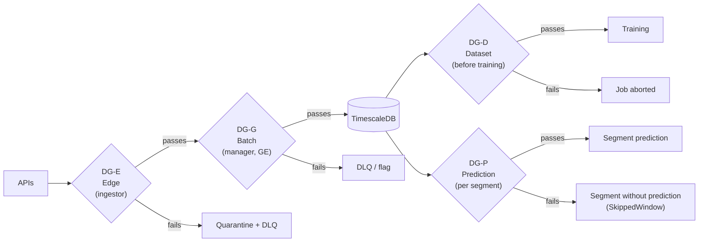

# Data Gates (DG)

> Framework: [README](README.md) · Sources: [05_data_sources.md](../05_data_sources.md) · Configuration: DG-E in [nodes/ingestor/config/quality.yaml](../../nodes/ingestor/config/quality.yaml) (per node, ADR-05) · DG-G/D/P in `config/quality/data_gates.yaml`
> Version 0.2 · all criteria **Provisional** unless stated otherwise.

## 1. Purpose
Ensure that **no broken or misleading data** reaches the database, a training dataset or a prediction. There are **four gates**, one at each point of the data's journey:



| Gate | Where | When | Tool | On failure (`block`) |
|---|---|---|---|---|
| **DG-E** Edge | Ingestor | Every new or revised reading | `mibel_ingestor.gates` (rules from the node's `quality.yaml`) | Data goes to local quarantine and its reason to `mibel.dlq` |
| **DG-G** Batch | Manager | Every 15-min window | Great Expectations | Data goes to the DLQ or is stored with a `quality_flag` |
| **DG-D** Dataset | Compute node (before training) | Every training Job | Great Expectations + point-in-time test | The Job ends without training and reports it |
| **DG-P** Prediction | Compute node (service) | Every window, **per segment** | `mibel_common` rules | That segment is not published (`SkippedWindow` with reason) |

## 2. DG-E · Edge gate (ingestor)
Lightweight rules: they must run on the Raspberry Pi 3B+. The ingestor's run mode picks the profile: `pro` and `test` → production, `dev` → development (ADR-05).

| ID | What it checks | Development | Production | Mode (dev / prod) | Status |
|---|---|---|---|---|---|
| DG-E01 | Structure matches its source contract (fields, types, version) | exact | exact | block / block | Fixed |
| DG-E02 | Mandatory fields not null | 100 % | 100 % | block / block | Fixed |
| DG-E03 | `event_time` aligned with its grid (5/15/60 min depending on source) and in UTC | exact | exact | block / block | Fixed |
| DG-E04 | `available_at ≥ event_time` for observations; `issued_at ≤ valid_at` for forecasts | exact | exact | block / block | Fixed |
| DG-E05 | `event_time` not in the future (observations) | ≤ now + 5 min | ≤ now + 5 min | block / block | Provisional |
| DG-E06 | Radiation (direct, diffuse) | 0 – 1,200 W/m² | 0 – 1,200 W/m² | block / block | Provisional |
| DG-E07 | Wind speed (80/120 m) | 0 – 60 m/s | 0 – 60 m/s | block / block | Provisional |
| DG-E08 | Temperature | −30 – 50 °C | −30 – 50 °C | block / block | Provisional |
| DG-E09 | Cloud cover | 0 – 100 % | 0 – 100 % | block / block | Fixed |
| DG-E10 | Peninsular demand | 10,000 – 50,000 MW | 10,000 – 50,000 MW | block / block | Provisional |
| DG-E11 | Generation by technology: ≥ −1 % of installed capacity for technologies that consume (thermal, storage), ≥ 0 for the rest; ≤ installed capacity × 1.05 | −1 % / × 1.05 | −1 % / × 1.05 | warn / block | Provisional |
| DG-E12 | Day-ahead and IDA price (harmonised market limits, [VERIFY] current values) | −500 – 4,000 €/MWh | −500 – 4,000 €/MWh | block / block | Provisional |
| DG-E13 | Continuous intraday price (technical limits, [VERIFY]) | −9,999 – 9,999 €/MWh | −9,999 – 9,999 €/MWh | block / block | Provisional |
| DG-E14 | Gas price (MIBGAS) | 0 – 500 €/MWh | 0 – 500 €/MWh | block / block | Provisional |
| DG-E15 | Normalised units (MW, €/MWh, m/s, W/m²) | exact | exact | block / block | Fixed |
| DG-E16 | OMIE continuous intraday: a period with max = min = VWAP = 0.00 means **no trades** and is treated as missing (not a 0 €/MWh price) | applied | applied | block / block | Provisional |

> **Negative prices are valid** (solar surplus). No rule may reject a price just for being negative.
> Installed capacity (DG-E11) is read from REData (`potencia-instalada`); it is not hard-coded. [VERIFY] the endpoint returned HTTP 500 on 2026-11-11: until it works, DG-E11 checks only the sign.

## 3. DG-G · Batch gate (manager)
Checks what a single data point cannot reveal: completeness, freshness, consistency between variables and temporal anomalies.

| ID | What it checks | Development | Production | Mode (dev / prod) | Status |
|---|---|---|---|---|---|
| DG-G01 | Duplicates (same `source, variable, node, event_time, available_at`) | discarded | discarded | block / block | Fixed |
| DG-G02 | Window completeness: % of expected variables received per source | ≥ 80 % | ≥ 95 % | warn / warn | Provisional |
| DG-G03 | ESIOS freshness (demand and generation) | ≤ 60 min | ≤ 30 min | warn / warn | Provisional |
| DG-G04 | D+1 day-ahead price available | before 15:00 on D | before 14:00 on D | warn / warn | Provisional |
| DG-G05 | Open-Meteo forecast freshness | ≤ 6 h | ≤ 3 h | warn / warn | Provisional |
| DG-G06 | MIBGAS price freshness | ≤ 3 business days | ≤ 1 business day | warn / warn | Provisional |
| DG-G07 | Balance: Σ generation + imports − exports ≈ demand (+ pumping) | ±15 % | ±8 % | warn / warn | Provisional |
| DG-G08 | **Frozen value**: the same reading repeated for variables that should vary | > 4 h | > 2 h | warn / warn | Provisional |
| DG-G09 | Anomalous jump (robust z-score against the last week) → **flag, not reject** (price spikes are real) | \|z\| > 8 | \|z\| > 6 | warn / warn | Provisional |
| DG-G10 | Cross-source consistency (ESIOS vs. REData, hourly aggregate) | ±10 % | ±5 % | off / warn | Provisional |
| DG-G11 | Rejection rate (DLQ) over 24 h, per source | warn 5 % · critical 20 % | warn 2 % · critical 10 % | warn / warn | Provisional |
| DG-G12 | Gap imputation: linear interpolation allowed, flagged `imputed` | ≤ 2 h | ≤ 1 h | — | Provisional |

## 4. DG-D · Dataset gate (before training)

| ID | What it checks | Development | Production | Mode (dev / prod) | Status |
|---|---|---|---|---|---|
| DG-D01 | Time coverage of the history | ≥ 3 months | ≥ 12 months | block / block | Provisional |
| DG-D02 | Completeness per feature | ≥ 90 % | ≥ 98 % | warn / block | Provisional |
| DG-D03 | **Point-in-time test**: no feature uses data with `available_at > as_of` | passed | passed | block / block | Fixed |
| DG-D04 | % of rows with imputed values | ≤ 10 % | ≤ 3 % | warn / block | Provisional |
| DG-D05 | DVC version registered and feature schema matching `features_version` | exact | exact | block / block | Fixed |
| DG-D06 | Target present for the whole *walk-forward* test period | ≥ 90 % | ≥ 98 % | block / block | Provisional |
| DG-D07 | Distribution change against the previous dataset version (PSI of stable features) | ≤ 0.5 | ≤ 0.25 | warn / warn | Provisional |
| DG-D08 | Data before Oct-2025 (hourly resolution) flagged and harmonised | flagged | flagged | block / block | Fixed |

## 5. DG-P · Prediction gate (per segment)
Evaluated **on every window and separately for each segment**. If a segment fails, **only that segment** has no prediction (`allow_partial_segments`).

| ID | What it checks | Segment | Development | Production | Mode (dev / prod) | Status |
|---|---|---|---|---|---|---|
| DG-P01 | Day-ahead price available for every quarter of the segment | both | 100 % | 100 % | block / block | Fixed |
| DG-P02 | Age of the latest demand and generation data | nowcast | ≤ 60 min | ≤ 30 min | warn / block | Provisional |
| | | forecast | ≤ 120 min | ≤ 60 min | warn / block | Provisional |
| DG-P03 | Age of the weather forecast | nowcast | ≤ 6 h | ≤ 3 h | warn / warn | Provisional |
| | | forecast | ≤ 6 h | ≤ 3 h | warn / block | Provisional |
| DG-P04 | Feature completeness over the last 24 h (below it: `low_confidence` flag) | both | ≥ 85 % | ≥ 95 % | warn / warn | Provisional |
| DG-P05 | Maximum imputed gap in the segment's features | both | ≤ 2 h | ≤ 1 h | warn / block | Provisional |
| DG-P06 | Critical features of the segment present (list in configuration) | both | 100 % | 100 % | warn / block | Provisional |

Default critical features:
- **Nowcast**: `demand_real`, `renewable_deviation`, `price_ida_latest`. The continuous price is published on D+1 (~03:00), so it is never available in real time: the target keeps being the real continuous VWAP, the latest IDA is the real-time reference, and the previous day's continuous price (`price_continuous_d1`) is an optional feature and the basis of the daily checks.
- **Forecast**: `wind_forecast`, `solar_forecast`, `weather`, `price_day_ahead`.
- A new segment (e.g. `extended`) inherits the `segment_defaults` values.

## 6. Configuration
```yaml
# config/quality/data_gates.yaml
active_profile: development          # development | production
criteria:
  DG-E06: {desc: "radiation W/m2", status: provisional,
           development: {value: [0, 1200], mode: block},
           production:  {value: [0, 1200], mode: block}}
  DG-E11: {desc: "generation ≤ installed", status: provisional,
           development: {value: 1.05, mode: warn},
           production:  {value: 1.05, mode: block}}
  DG-G03: {desc: "ESIOS freshness (min)", status: provisional,
           development: {value: 60, mode: warn},
           production:  {value: 30, mode: warn}}
  DG-D01: {desc: "history coverage (months)", status: provisional,
           development: {value: 3, mode: block},
           production:  {value: 12, mode: block}}
  DG-P02:
    desc: "system data age (min)"
    status: provisional
    segments:
      nowcast:  {development: {value: 60,  mode: warn}, production: {value: 30, mode: block}}
      forecast: {development: {value: 120, mode: warn}, production: {value: 60, mode: block}}
  # … one block per criterion, with the same shape
segment_defaults:                    # for new segments
  DG-P02: {development: {value: 120, mode: warn}, production: {value: 60, mode: block}}
  DG-P03: {development: {value: 6,   mode: warn}, production: {value: 3,  mode: block}}
critical_features:
  nowcast:  [demand_real, renewable_deviation, price_ida_latest]
  forecast: [wind_forecast, solar_forecast, weather, price_day_ahead]
```

## 7. Specific calibration
- **Physical ranges (DG-E06 … DG-E14)**: review the real maxima and minima of a one-year backfill; the threshold is set with a margin over the historical extreme, not over the 99th percentile, because extremes are legitimate.
- **Freshness (DG-G03 … DG-G06, DG-P02, DG-P03)**: measure each source's real latency in SP-01 and set the threshold at the 99th percentile of that latency plus a margin.
- **Anomalies (DG-G08, DG-G09)**: count how many flags would have fired on the backfill and manually review a sample to estimate false positives.

## 8. Changelog
| Date | Criterion | Before → After | Reason | Author |
|---|---|---|---|---|
| 2026-11-08 | All | — → v0.1 | Document created from the former quality baseline | — |
| 2026-11-08 | All | Spanish → English, `CD-` → `DG-` | Repository content in English (A-21) | — |
| 2026-11-11 | DG-E11 | ≥ 0 → ≥ −1 % of installed capacity (thermal, storage) | Small legitimate negative values (auxiliary consumption) seen in REData (docs/05 §7.2) | Maintainer |
| 2026-11-11 | DG-E16 | — → new (no-trade periods → missing) | OMIE writes 0.00 when a period has no trades (docs/05 §7.2) | Maintainer |
| 2026-11-11 | DG-P06 | nowcast `price_continuous_last` → `price_ida_latest` | The continuous price only exists on D+1 (docs/05 §7.1) | Maintainer |
| 2026-11-11 | DG-E (all) | `config/quality/data_gates.yaml` → `nodes/ingestor/config/quality.yaml` | Per-node quality files, ingestor deployable alone (ADR-05) | Maintainer |
