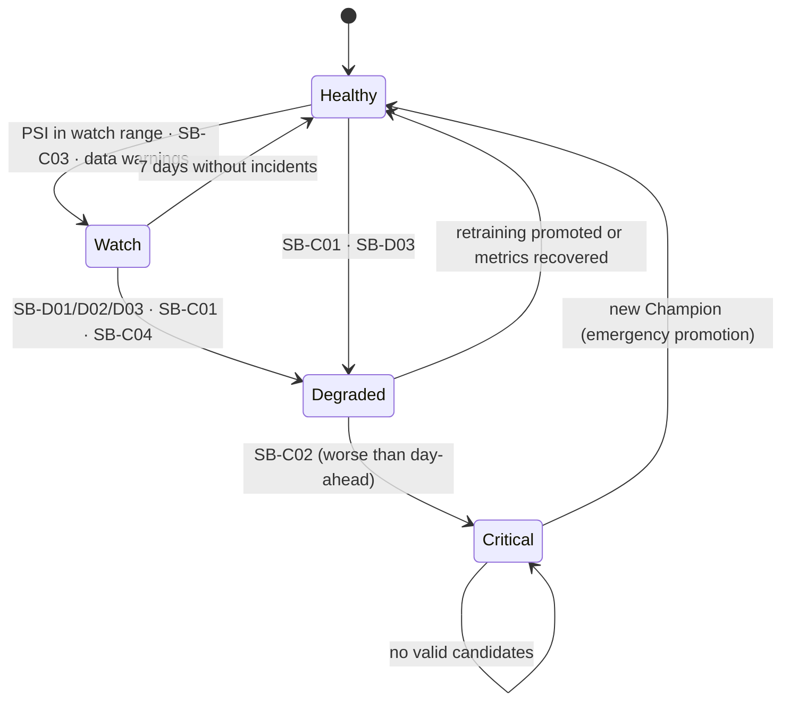

# Model Service Baseline (SB)

> Framework: [README](README.md) · Horizon and segments: ADR-04 · Format: ADR-03 (both in [06_technical_decisions.md](../06_technical_decisions.md)) · Configuration: `config/quality/service_baseline.yaml`
> Version 0.1 · all criteria **Provisional** unless stated otherwise.

## 1. Purpose
Defines the **minimum every model must meet to be deployed** (to receive any alias, Challenger or Champion) and **to remain valid while in service**. A model that does not meet the baseline:
- **is not deployed** (*Rejected* state); or
- if already deployed, **loses its validity**, triggering retraining or emergency promotion.

This document **does not compare models with each other**; that belongs to the [promotion criteria](03_promotion_criteria.md).

| Block | When it is evaluated | Where |
|---|---|---|
| SB-P Accuracy | At the end of training (*walk-forward* backtest) | Compute node |
| SB-T Technical integrity | On export and registration | Compute node |
| SB-R Performance | In a load test before the alias is assigned | Compute node |
| SB-S Service | Continuously, in production | Manager (with stored predictions) |
| SB-D / SB-C Drift | Daily, in production | Manager (without loading models) |

## 2. Measurement context
- **Target**: volume-weighted average price of the continuous intraday market per quarter-hour.
- **Horizon**: 8 quarters. Segments: **nowcast** h1–h4 and **forecast** h5–h8 (configurable).
- **Main baseline**: the **day-ahead market price** for the same quarter. **rMAE<sub>DA</sub> = MAE<sub>model</sub> / MAE<sub>DA</sub>**: a value < 1 means the model adds something over day-ahead.
- **Aggregate**: weighted mean of segments (nowcast 0.4 · forecast 0.6).
- **Metrics**: MAE (main), rMAE<sub>DA</sub>, RMSE, bias, *spread* direction accuracy (sign of ŷ − DA vs. sign of y − DA), MAE in ramp hours (07–10 and 18–22) and at low prices (≤ 5 €/MWh). **MAPE is not used.**

## 3. SB-P · Accuracy (*walk-forward* backtest)

| ID | Criterion | Segment | Development | Production | Mode (dev / prod) | Status |
|---|---|---|---|---|---|---|
| SB-P00 | Length of the *walk-forward* test period | — | 4 weeks | 8 weeks | — | Provisional |
| SB-P01 | rMAE<sub>DA</sub> | nowcast | ≤ 1.00 | ≤ 0.85 | warn / block | Provisional |
| | | forecast | ≤ 1.05 | ≤ 0.95 | warn / block | Provisional |
| | | aggregate | ≤ 1.00 | ≤ 0.90 | block / block | Provisional |
| SB-P02 | \|Bias\| | nowcast | ≤ 6 €/MWh | ≤ 3 €/MWh | warn / block | Provisional |
| | | forecast | ≤ 8 €/MWh | ≤ 4 €/MWh | warn / block | Provisional |
| SB-P03 | *Spread* direction accuracy | nowcast | ≥ 50 % | ≥ 55 % | off / warn | Provisional |
| | | forecast | ≥ 50 % | ≥ 55 % | warn / block | Provisional |
| SB-P04 | No individual horizon with rMAE<sub>DA</sub> > X | both | 1.15 | 1.05 | warn / warn | Provisional |
| SB-P05 | No test week with rMAE<sub>DA</sub> > X (aggregate) | — | 1.40 | 1.20 | warn / warn | Provisional |
| SB-P06 | MAE in ramp hours not worse than day-ahead | both | rMAE ≤ 1.10 | rMAE ≤ 1.00 | off / warn | Provisional |

> In development, a model that **matches** day-ahead (aggregate rMAE ≤ 1.0) can be deployed to test the full loop.

## 4. SB-T · Technical integrity

| ID | Criterion | Development | Production | Mode (dev / prod) | Status |
|---|---|---|---|---|---|
| SB-T01 | Exported to **ONNX** with the common *opset* | mandatory | mandatory | block / block | Fixed |
| SB-T02 | Native ↔ ONNX parity (maximum difference on the test set) | < 0.05 €/MWh | < 0.01 €/MWh | block / block | Provisional |
| SB-T03 | Accepts exactly the `FeatureVector` of the current version | exact | exact | block / block | Fixed |
| SB-T04 | Output `[n, H]` consistent with the `horizon_quarters` and `segments` metadata | exact | exact | block / block | Fixed |
| SB-T05 | Finite outputs within market limits | [−9,999, 9,999] €/MWh | [−9,999, 9,999] €/MWh | block / block | Provisional |
| SB-T06 | Reproducibility (same commit, data and seed) | ΔMAE ≤ 5 % | ΔMAE ≤ 1 % | off / warn | Provisional |
| SB-T07 | Full lineage in MLflow (DVC hash, commit, parameters, metrics, model card) | complete | complete | block / block | Fixed |
| SB-T08 | Trained on a dataset that passed the [DG-D gates](01_data_gates.md) | yes | yes | block / block | Fixed |

## 5. SB-R · Performance

| ID | Criterion | Development | Production | Mode (dev / prod) | Status |
|---|---|---|---|---|---|
| SB-R01 | Inference latency p95 (8 values, no features) on CPU | ≤ 500 ms | ≤ 100 ms | warn / block | Provisional |
| SB-R02 | Inference latency p95 on GPU | ≤ 200 ms | ≤ 50 ms | warn / block | Provisional |
| SB-R03 | Total latency p95 (features + inference + write) | ≤ 120 s | ≤ 30 s | warn / block | Provisional |
| SB-R04 | Time to *ready* (download + load ONNX) | ≤ 180 s | ≤ 60 s | warn / warn | Provisional |
| SB-R05 | ONNX artifact size | ≤ 1 GB | ≤ 500 MB | warn / block | Provisional |
| SB-R06 | RAM per pod | ≤ 3 GB | ≤ 1.5 GB | warn / block | Provisional |
| SB-R07 | VRAM per pod | ≤ 4 GB | ≤ 2 GB | warn / warn | Provisional |
| SB-R08 | Training duration on the reference node | ≤ 180 min | ≤ 60 min | off / warn | Provisional |

## 6. SB-S · Service (in production)

| ID | Criterion | Development | Production | Mode (dev / prod) | Status |
|---|---|---|---|---|---|
| SB-S01 | Freshness: prediction stored after the window closes, p95 | ≤ 10 min | ≤ 5 min | warn / warn | Provisional |
| SB-S02 | Coverage in operational mode, per segment | ≥ 90 % | ≥ 99 % | warn / warn | Provisional |
| SB-S03 | Total coverage (including periods without compute) | measured | measured | off / off | Fixed |
| SB-S04 | Windows lost during a Champion change | ≤ 2 | 0 | warn / warn | Provisional |

## 7. Validity in service: drift

### 7.1 SB-D · Data drift (model-free)
- **Reference**: the last 90 days of the training dataset.
- **Window**: the last 7 days.
- **Metric**: PSI per feature (< 0.10 stable · 0.10–0.25 watch · > 0.25 drift).

| ID | Rule | Development | Production | Mode (dev / prod) | Status |
|---|---|---|---|---|---|
| SB-D01 | PSI of a critical feature of the segment (lists in [DG-P06](01_data_gates.md)) | > 0.40 | > 0.25 | warn / block | Provisional |
| SB-D02 | Multiple drift: number of features with PSI > threshold | ≥ 5 | ≥ 3 | warn / block | Provisional |
| SB-D03 | Extrapolation: gas, thermal gap or day-ahead price outside the training range ± margin for ≥ 1 day | ± 20 % | ± 10 % | warn / block | Provisional |

### 7.2 SB-C · Concept drift (with stored predictions, model-free)

| ID | Rule | Segment | Development | Production | Mode (dev / prod) | Status |
|---|---|---|---|---|---|---|
| SB-C01 | 7-day rolling MAE / validation MAE, for 3 days | nowcast | > 1.6 × | > 1.3 × | warn / block | Provisional |
| | | forecast | > 1.5 × | > 1.25 × | warn / block | Provisional |
| SB-C02 | 7-day rolling rMAE<sub>DA</sub>, for 2 days (worse than day-ahead) | both | > 1.10 | > 1.00 | warn / block | Provisional |
| SB-C03 | Anomalous day: daily MAE > X × validation | both | 4 × | 3 × | warn / warn | Provisional |
| SB-C04 | 7-day rolling \|bias\| | nowcast | > 8 €/MWh | > 5 €/MWh | warn / block | Provisional |
| | | forecast | > 10 €/MWh | > 6 €/MWh | warn / block | Provisional |

## 8. Health states and reaction
Each segment has its own state. **The model's state is the worst of its segments.**



| State | Action |
|---|---|
| Healthy | None |
| Watch | Dashboard in yellow (per segment) |
| Degraded | Retraining order |
| Critical | Urgent retraining + emergency path of the [promotion criteria](03_promotion_criteria.md) (§5). If there is no candidate, the Champion keeps running, flagged `critical` in the affected segment (there is no fallback) |

| Reaction parameter | Development | Production | Status |
|---|---|---|---|
| Cooldown between retraining orders | 6 h | 24 h | Provisional |
| Minimum days of new data to retrain | 1 | 2 | Provisional |
| Scheduled retraining even without drift | weekly | every 2 weeks | Provisional |

## 9. Model card (in MLflow)
`family` · `ONNX opset` · `horizon_quarters` · `segments` · `features_version` · `DVC hash` · `commit` · `training and test periods` · `metrics per horizon and segment` · `p95 latencies` · `size` · `RAM/VRAM` · `training node` · **`result of each SB-xx criterion` (value, threshold, profile, pass/fail)** · `author`

## 10. Configuration
```yaml
# config/quality/service_baseline.yaml
active_profile: development
reference: day_ahead
segment_weights: {nowcast: 0.4, forecast: 0.6}
criteria:
  SB-P01:
    desc: "rMAE against day-ahead"
    status: provisional
    segments:
      nowcast:   {development: {value: 1.00, mode: warn},  production: {value: 0.85, mode: block}}
      forecast:  {development: {value: 1.05, mode: warn},  production: {value: 0.95, mode: block}}
      aggregate: {development: {value: 1.00, mode: block}, production: {value: 0.90, mode: block}}
  SB-T02:
    desc: "ONNX parity (€/MWh)"
    status: provisional
    development: {value: 0.05, mode: block}
    production:  {value: 0.01, mode: block}
  SB-R01:
    desc: "CPU latency p95 (ms)"
    status: provisional
    development: {value: 500, mode: warn}
    production:  {value: 100, mode: block}
  SB-C01:
    desc: "7d MAE / validation MAE"
    status: provisional
    days: 3
    segments:
      nowcast:  {development: {value: 1.6, mode: warn}, production: {value: 1.3,  mode: block}}
      forecast: {development: {value: 1.5, mode: warn}, production: {value: 1.25, mode: block}}
  # … one block per criterion
segment_defaults:            # inherited by new segments
  SB-P01: {development: {value: 1.10, mode: warn}, production: {value: 1.00, mode: block}}
  SB-P02: {development: {value: 10,   mode: warn}, production: {value: 5,    mode: block}}
  SB-C01: {development: {value: 1.5,  mode: warn}, production: {value: 1.2,  mode: block}}
reaction:
  development: {cooldown_h: 6,  min_new_days: 1, scheduled_retrain_weeks: 1}
  production:  {cooldown_h: 24, min_new_days: 2, scheduled_retrain_weeks: 2}
```

## 11. Specific calibration
- **SB-P01**: after the first backtest with the 5 families, place the production threshold so that **at least one family** passes and is clearly better than day-ahead. If none goes below 0.95, the problem lies in the features, not in the threshold.
- **SB-R**: measure on the reference node (RTX 5060 Ti) and on a CPU-only node; set with a ×2 margin over the observed p95.
- **SB-D / SB-C**: leave them in `warn` for 4–8 weeks and count how many alerts would have triggered retraining. The guideline target is **≤ 2 drift-triggered retrainings per month** under normal conditions.

## 12. Changelog
| Date | Criterion | Before → After | Reason | Author |
|---|---|---|---|---|
| 2026-11-08 | All | — → v0.1 | Created from the former quality baseline; development profile added | — |
| 2026-11-08 | All | Spanish → English, `LS-` → `SB-` | Repository content in English (A-21) | — |
