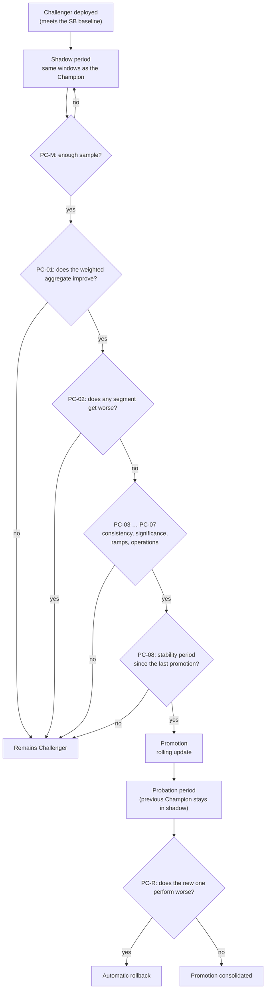

# Promotion Criteria: Challenger vs. Champion (PC)

> Framework: [README](README.md) · Prerequisite: [service baseline](02_service_baseline.md) · Configuration: `config/quality/promotion.yaml`
> Version 0.1 · all criteria **Provisional** unless stated otherwise.

## 1. Purpose
Decide **when a Challenger is enough better than the Champion to replace it**, and when a promotion must be **undone**. The goal is twofold:
- **Do not miss real improvements**: if a model is better, it should end up serving.
- **Do not switch because of noise**: every Champion change has a cost (risk, dashboard instability) and must be justified by data.

## 2. Flow



## 3. Prerequisites (must always hold)

| ID | Prerequisite | Mode |
|---|---|---|
| PC-00a | The Challenger **meets the service baseline** (all blocking SB criteria of the active profile) | block |
| PC-00b | Both models are compared **on the same windows**: only windows where both made a prediction count | block |
| PC-00c | Same target and same segment definition (if segments differ, only common segments are compared) | block |

## 4. Comparison criteria (normal path)

### 4.1 Minimum sample
| ID | Criterion | Development | Production | Mode (dev / prod) | Status |
|---|---|---|---|---|---|
| PC-M1 | Days in shadow | ≥ 2 days | ≥ 7 days | block / block | Provisional |
| PC-M2 | Comparable windows per segment | ≥ 150 | ≥ 600 | block / block | Provisional |
| PC-M3 | Challenger coverage in shadow, per segment | ≥ 90 % | ≥ 99 % | warn / block | Provisional |

### 4.2 Improvement
| ID | Criterion | Development | Production | Mode (dev / prod) | Status |
|---|---|---|---|---|---|
| PC-01 | **MAE improvement on the weighted aggregate** (nowcast 0.4 · forecast 0.6) | ≥ 1 % | ≥ 3 % | block / block | Provisional |
| PC-02 | **No regression per segment**: no segment worsens its MAE by more than X | ≤ 3 % | ≤ 1 % | warn / block | Provisional |
| PC-03 | **Consistency**: the Challenger wins (lower daily aggregate MAE) on at least X % of the shadow days | ≥ 50 % | ≥ 60 % | off / block | Provisional |
| PC-04 | **Significance**: Diebold-Mariano test on the aggregate errors | p < 0.20 | p < 0.05 | off / warn | Provisional |
| PC-05 | Ramp hours: the Challenger's MAE does not worsen by more than X | ≤ 10 % | ≤ 5 % | off / warn | Provisional |
| PC-06 | *Spread* direction accuracy in the forecast segment: does not drop by more than X points | ≤ 5 pp | ≤ 2 pp | off / block | Provisional |
| PC-07 | Operations: Challenger p95 latency and RAM ≤ X × the Champion's (always within SB-R) | ≤ 3 × | ≤ 1.5 × | warn / warn | Provisional |

### 4.3 Stability and tie-breaking
| ID | Criterion | Development | Production | Mode (dev / prod) | Status |
|---|---|---|---|---|---|
| PC-08 | Minimum time since the last promotion | 12 h | 72 h | block / block | Provisional |
| PC-09 | Maximum normal promotions per week | 5 | 1 | block / block | Provisional |
| PC-10 | **Tie zone**: if the aggregate improvement is between 0 and the PC-01 threshold, **the Champion is kept** | — | — | — | Fixed |
| PC-11 | Several Challengers qualify at once → promote the one with the **largest aggregate improvement**; if tied (±0.5 %), the one with the **lowest latency**, then the **smallest size** | — | — | — | Fixed |

## 5. Special paths

| Path | When | Conditions | Status |
|---|---|---|---|
| **Emergency** | The Champion is **Critical** in some segment (SB-C02, worse than day-ahead) | Meets the baseline in the backtest · over the last 2 weeks its rMAE<sub>DA</sub> in the **critical segment** is better than the Champion's · no shadow period and no PC-08 | Provisional |
| **Manual** | Human decision (e.g. for a demo) | Must meet the baseline (PC-00a). Recorded with author and reason in MLflow | Fixed |
| **First Champion** | None exists yet | The best model that meets the baseline becomes Champion directly | Fixed |

## 6. Probation period and automatic rollback
After a normal promotion, **the previous Champion becomes a Challenger** and keeps predicting in shadow. The comparison therefore continues on real data.

| ID | Criterion | Development | Production | Mode (dev / prod) | Status |
|---|---|---|---|---|---|
| PC-R1 | Probation period length | 24 h | 72 h | — | Provisional |
| PC-R2 | **Automatic rollback** if, during probation, the new Champion's aggregate MAE is worse than the previous one by more than X | > 5 % | > 3 % | warn / block | Provisional |
| PC-R3 | Automatic rollback if the new Champion enters the **Critical** state | yes | yes | warn / block | Provisional |
| PC-R4 | A rolled-back model cannot be promoted again until it is retrained | yes | yes | block / block | Fixed |

After a rollback, the rolled-back model becomes *Retired* and its lineage is protected according to the [retention policy](../04_retention_policy.md).

## 7. Configuration
```yaml
# config/quality/promotion.yaml
active_profile: development
segment_weights: {nowcast: 0.4, forecast: 0.6}     # same weights as the baseline
criteria:
  PC-M1: {desc: "days in shadow", status: provisional,
          development: {value: 2, mode: block}, production: {value: 7, mode: block}}
  PC-M2: {desc: "comparable windows per segment", status: provisional,
          development: {value: 150, mode: block}, production: {value: 600, mode: block}}
  PC-01: {desc: "aggregate MAE improvement", status: provisional,
          development: {value: 0.01, mode: block}, production: {value: 0.03, mode: block}}
  PC-02: {desc: "max regression per segment", status: provisional,
          development: {value: 0.03, mode: warn}, production: {value: 0.01, mode: block}}
  PC-03: {desc: "% of days won", status: provisional,
          development: {value: 0.50, mode: off}, production: {value: 0.60, mode: block}}
  PC-04: {desc: "Diebold-Mariano p", status: provisional,
          development: {value: 0.20, mode: off}, production: {value: 0.05, mode: warn}}
  PC-08: {desc: "hours since last promotion", status: provisional,
          development: {value: 12, mode: block}, production: {value: 72, mode: block}}
  PC-R2: {desc: "rollback if worse", status: provisional,
          development: {value: 0.05, mode: warn}, production: {value: 0.03, mode: block}}
  # … one block per criterion
tie_break: [aggregate_improvement, p95_latency_ms, artifact_mb]
emergency:
  enabled: true
  lookback_days: 14
```

## 8. Specific calibration
- **PC-01 (minimum improvement)**: with two copies of the **same** model trained with different seeds, measure the week-to-week MAE difference. That difference is **pure noise**, and the threshold must exceed it comfortably (guideline: ≥ 2 × the 90th percentile of the noise).
- **PC-M1 / PC-M2 (sample)**: check with the backtest how many days are needed for the confidence interval of the MAE difference to be smaller than the PC-01 threshold.
- **PC-R2 (rollback)**: must be **larger** than the 72-hour noise; otherwise rollbacks would happen by chance.

## 9. Changelog
| Date | Criterion | Before → After | Reason | Author |
|---|---|---|---|---|
| 2026-11-08 | All | — → v0.1 | Created from the former quality baseline §8; added consistency, tie-breaking, probation and automatic rollback | — |
| 2026-11-08 | All | Spanish → English, `CP-` → `PC-` | Repository content in English (A-21) | — |
