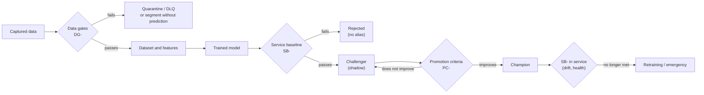
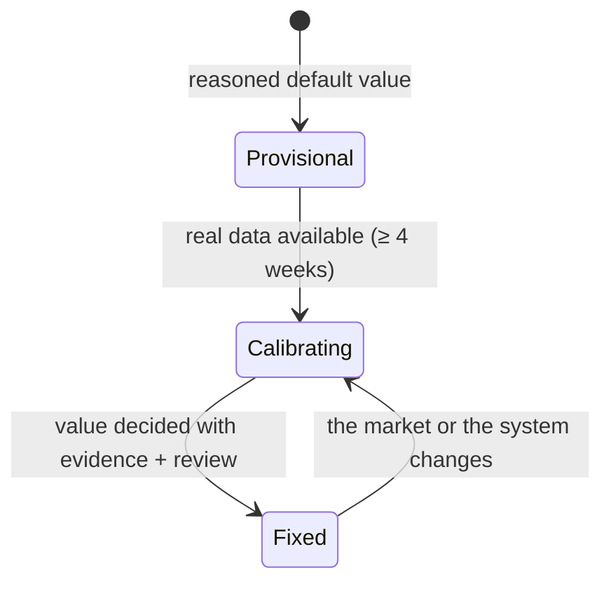

# MIBEL-Ops — Quality Framework

> Horizon and segments: ADR-04 in [06_technical_decisions.md](../06_technical_decisions.md)

Quality is controlled through **three independent documents**, each with its own configuration file. They can be changed separately: changing a data gate does not require reviewing the promotion criteria, and vice versa.

| Document | Question it answers | Prefix | Configuration |
|---|---|---|---|
| [01_data_gates.md](01_data_gates.md) | Is this data reliable enough to store, train on or predict with? | `DG-` | `config/quality/data_gates.yaml` |
| [02_service_baseline.md](02_service_baseline.md) | Is this model valid for deployment, and does it remain valid in service? | `SB-` | `config/quality/service_baseline.yaml` |
| [03_promotion_criteria.md](03_promotion_criteria.md) | Is this Challenger better enough than the Champion to replace it? | `PC-` | `config/quality/promotion.yaml` |

## How they fit together

**Hierarchy rule:** a model **can only compete** (PC) if it **meets the baseline** (SB), and the baseline is only evaluated on **data that passed the gates** (DG).

## Profiles: development and production
Each criterion has **two values**, one per profile. The active profile is selected in each file with `active_profile`.

| Profile | Purpose | Behaviour |
|---|---|---|
| `development` | Testing while the system is being built | Loose thresholds; many criteria in `warn` mode (recorded but not blocking). Allows deploying imperfect models to test the full loop |
| `production` | Real service | Final thresholds; blocking criteria in `block` mode |

Each criterion also has a **mode**, independent of the profile:

| Mode | Effect |
|---|---|
| `block` | If not met, it blocks (data discarded, model rejected, promotion denied) |
| `warn` | Recorded, shown in Grafana and notified, but does not block |
| `off` | Not evaluated (useful while the required data does not yet exist, e.g. before SP-01) |

## Criterion lifecycle
To **make fixing the criteria easy when moving to production**, each criterion carries a maturity status:

| Status | Meaning | Requirement to advance |
|---|---|---|
| **Provisional** | Default value based on team judgement or the literature | — |
| **Calibrating** | Its real distribution is being measured with the system running | ≥ 4 weeks of data with the criterion in `warn` mode |
| **Fixed** | Final value for production | Calibration report (see "Procedure") + changelog entry |

**Condition for declaring the service in production:** every blocking criterion in all three documents is **Fixed** and in `block` mode in the `production` profile.

## Common calibration procedure
1. Put the criterion in `warn` mode in the `development` profile and let it run for at least 4 weeks.
2. Export its historical distribution (Superset "Calibration" dashboard): percentiles 50, 90, 95 and 99, and the cases it would have blocked.
3. Propose the threshold. Guidelines:
   - **Data gates**: the 99th percentile of normal behaviour (so it only blocks anomalies).
   - **Baseline**: the value that separates models that add value from those that do not, relative to the day-ahead baseline.
   - **Promotion**: the minimum improvement that exceeds week-to-week noise.
4. Review how many events the proposed threshold would have blocked (false positives) and how many real problems it would have let through.
5. Change the status to **Fixed**, update the `production` value and add a line to the document's changelog.

## Changelog per document
Each document ends with a table `Date · Criterion · Before → After · Reason · Author`. It is the record of why each threshold has its value.
